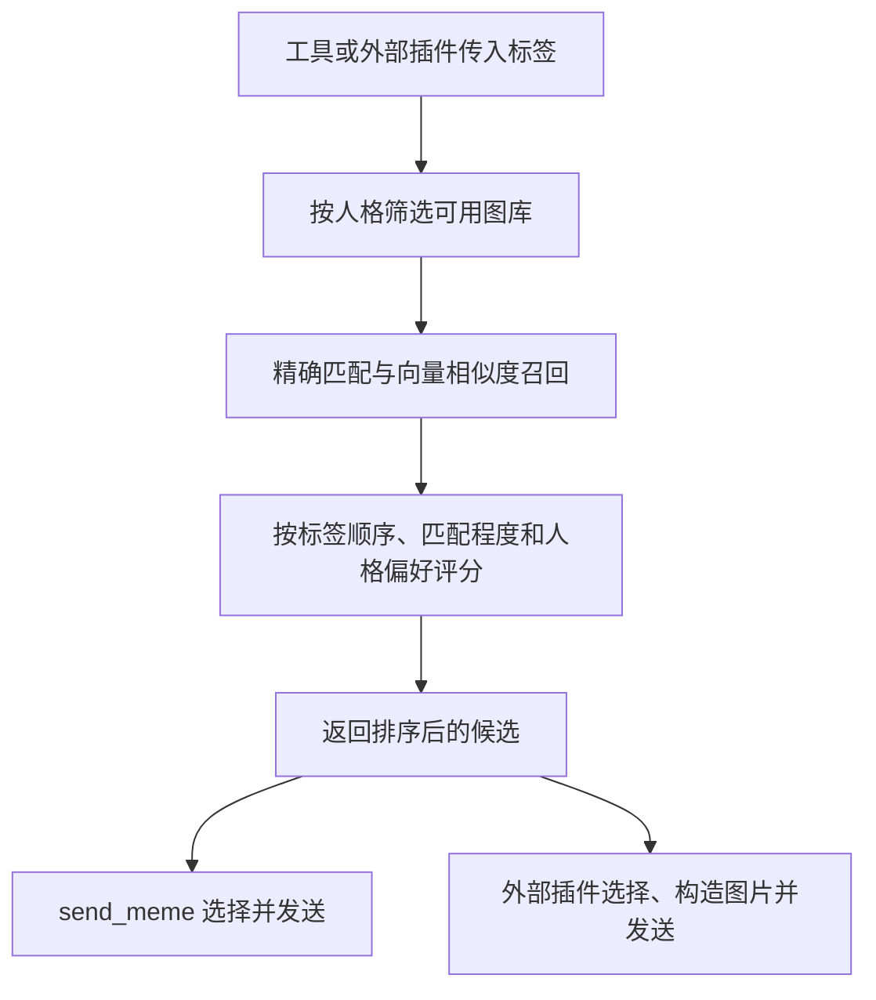

# AstrBot 表情包管理器

基于标签和 Embedding 检索本地表情包，通过 `send_meme` 工具或外部插件接口选择并发送。

本项目基于 [anka-afk/astrbot_plugin_meme_manager](https://github.com/anka-afk/astrbot_plugin_meme_manager) 开发，感谢原作者及贡献者。本仓库由维护者独立维护，功能、配置与发布以本仓库文档为准；问题与建议请提交到[本仓库 Issues](https://github.com/Yao-lin101/astrbot_plugin_meme_manager/issues)。

当前版本 [v5.0.1](CHANGELOG.md#v501)

## 快速开始

1. 在 AstrBot 插件管理中，通过[本仓库地址](https://github.com/Yao-lin101/astrbot_plugin_meme_manager)安装插件并启用。
2. 打开插件的「表情包管理」页面，上传图片、添加标签，并按需设置适用人格。图库需自行添加，本版本不附带预设图片。
3. 在 AstrBot 中配置 Embedding 提供商，并在「配置管理 → 检索与去重」选择 `embedding_provider_id`。留空时使用第一个可用的 Embedding 提供商；没有可用提供商时仍可精确匹配标签。
4. 使用支持工具调用的对话模型，尝试让它调用 `send_meme` 发送表情包；也可通过外部插件接入下述检索接口。

图床用于可选的云端图片同步。自动收录、AI 分析与人格偏好的设置见[详细使用说明](docs/usage.md)。

## 表情选择与发送流程

查询示例：`猫猫, 开心`。标签越靠前，匹配权重越高；人格使用偏好的首个标签用于小幅加分。

- **工具发送**：模型先调用 `send_meme(query="猫猫, 开心")` 获取候选，再调用 `send_meme(index=1)` 选择并发送。候选缓存在当前会话中，第二次调用可省略 `query`。
- **外部插件发送**：调用 `get_direct_trigger_memes(sender, event, raw_tags)`，按当前人格检索，未匹配时返回空列表；也可调用 `get_candidate_memes(persona_id, query, count, event)` 指定人格和数量。两者仅返回候选，由调用方选择图片、使用 `build_meme_component()` 构造组件并发送。具体模块路径与示例见[接口说明](docs/usage.md#外部插件接口)。

插件不向主 agent 的人格提示词注入指令，也不解析普通回复中的表情标签或追加图片。发送时机由工具调用或接入插件决定。

[详细使用说明](docs/usage.md) · [更新日志](CHANGELOG.md) · [协作规则](CONTRIBUTING.md) · [MIT 许可证](LICENSE)
